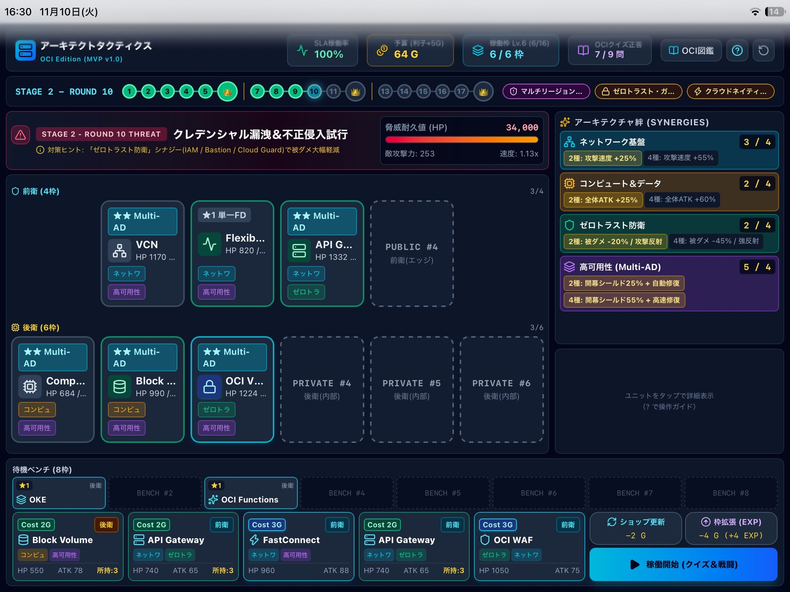

# ☁️ アーキテクトタクティクス (Architect Tactics) - OCI Edition

**アーキテクトタクティクス（OCI Edition）** は、アーキテクチャ設計・知識を戦術に昇華させる**デッキ構築型オートバトラー**です。『崩壊：スターレイル』のマネーウォーズに着想を得て、**OCI（Oracle Cloud Infrastructure）** のサービスを編成・配置し、冗長化やシナジーで戦い抜くゲームに仕上げました。
遊びながら **OCI 認定資格（Architect Associate / Professional）** および実務で役立つ知識が身につく設計になっています。



### 🎮 オンラインで今すぐプレイ
**[https://architect-tactics.pages.dev](https://architect-tactics.pages.dev)**
*(PC / スマホ / iPadブラウザでそのまま動作します)*

## ✨ 主な特徴

- **OCI 主要15サービス × 前衛・後衛スロット配置** と、4つのアーキテクチャシナジー（絆）
- **冗長化スケールアップ合成**：★1（単一 FD）→ ★2（Multi-AD）→ ★3（Cross-Region）
- **全100問の OCI 実践4択クイズ**（未出題優先ランダム出題・解説付き）
- **全3ステージ・計18ラウンド制**（中ボス＋最終決戦ボス「グローバルリージョン全損クライシス」）
- **全8種類の「設計戦略（オーグメント）」** による分岐ビルド構築
- **iPad 第9世代 / スマホ / PC 対応**（iPad / モバイル全画面Webアプリ対応：Safariのホーム画面追加による全画面アプリ動作）

## 🛠 技術スタック

| 区分 | 内容 |
| --- | --- |
| Frontend | React 19, TypeScript, Vite, Tailwind CSS, Lucide React |
| Hosting | Cloudflare Pages |
| Development | Claude Code & Gemini |

## 🚀 ローカルでの起動方法

```bash
npm install
npm run dev
```

ブラウザで表示された URL（通常 `http://localhost:5173`）を開いてください。

本番ビルドは `npm run build`、確認は `npm run preview` で行えます。

## 📄 ライセンス

ライセンスは設定していません。**All rights reserved（全著作権保有）** です。

## ⚠️ 免責事項 (Disclaimer)

本プロジェクトは個人の技術学習およびポートフォリオを目的として制作された非公式（ファンメイド）の作品であり、Oracle Corporation および HoYoverse (miHoYo) との提携・関係は一切ありません。
